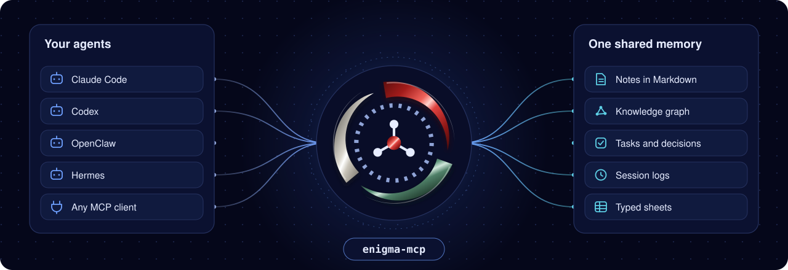
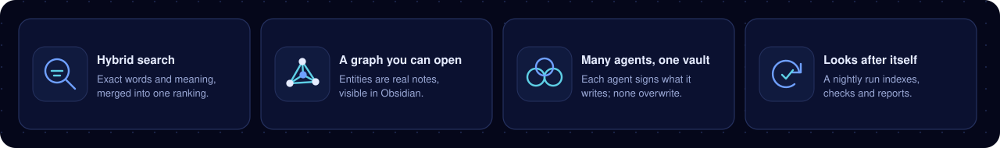

<p align="center">
  
</p>

<h1 align="center">Enigma MCP</h1>

<p align="center"><b>One memory for all your AI agents, kept as plain notes in your Obsidian vault.</b></p>

<p align="center">
  <a href="https://github.com/Rayhanson-Git/enigma/actions/workflows/ci.yml"></a>
  
  
  
  
  
  
</p>

<p align="center">
  <a href="#about">About</a> |
  <a href="#architecture">Architecture</a> |
  <a href="#features">Features</a> |
  <a href="#quick-start">Quick start</a> |
  <a href="#mcp-client-configuration">Client configuration</a> |
  <a href="#tool-reference">Tool reference</a> |
  <a href="#configuration">Configuration</a> |
  <a href="#operator-commands">Operator commands</a> |
  <a href="#retrieval-quality">Retrieval quality</a> |
  <a href="#contributing">Contributing</a>
</p>

## About

An AI agent starts every session with an empty head. What Claude Code worked out yesterday is unknown to Codex today, and
unknown to Claude Code itself tomorrow. Enigma gives all of them one place to remember: a folder of Markdown notes that
you already open in Obsidian.

`enigma-mcp` is a single Rust binary that sits in front of that folder and speaks the Model Context Protocol. Every agent
that connects gets the same 25 tools: search the vault, read and write notes, follow the knowledge graph, log a session,
add a task. The notes stay yours. You can read, edit, move and back them up like any other files.

<p align="center">
  
</p>

What you get that a vector database behind an MCP wrapper does not give you:

- **Search by words and by meaning.** A keyword ranking and an embedding ranking are merged into one result list.
- **A graph you can open.** Entities are ordinary notes under `Claude/Graph/`, so Obsidian's graph view shows them.
- **Write rules enforced in code.** Agents write inside `Claude/`. Anything else needs an explicit confirmation.
- **A vault that looks after itself.** One nightly run indexes new notes, suggests filing, checks health and reports.
- **Nothing you cannot rebuild.** Every cache lives outside the vault and can be deleted and rebuilt from the notes.

<p align="center">
  
</p>

<p align="center"><sub>A real vault growing in the order its notes were created: 2,935 nodes and 7,844 links. This is a recording of Obsidian's own
graph animation, about three and a half minutes sped up to fourteen seconds. The counter shows the graph's own node and link
counts at each moment. Note titles are hidden.</sub></p>

### Who it is for

- You use more than one AI agent and want them to share what they learn.
- You keep notes in Obsidian and want agents to add to them without making a mess.
- You want memory that survives a new laptop: copy the vault, rebuild the caches.

### Status

Version 1.3.0. Used daily on one private vault of about 1,570 notes with four agent harnesses connected at once.
Built and tested on macOS (Apple silicon), Linux and Windows: every push is linted, tested and built on all three by
[GitHub Actions](https://github.com/Rayhanson-Git/enigma/actions). Daily use so far has been on macOS only.
Scheduling uses launchd, so the `schedule` command is macOS only.

> **Windows is new in 1.3.0.** It builds and passes its tests on GitHub's Windows machines, but it has not yet been
> used day to day on a Windows PC. Please open an issue for anything that behaves differently there.

The organizer and the Librarian change files. Run them with `--dry-run` first; the Librarian refuses its first real
run on a vault until you have done so.

## Architecture

```mermaid
%%{init: {"theme": "base", "flowchart": {"curve": "basis"}, "themeVariables": {"primaryColor": "#101A3E", "primaryTextColor": "#F2F5FF", "primaryBorderColor": "#6FA0FF", "lineColor": "#7C9BEA", "clusterBkg": "#070B22", "clusterBorder": "#3D6BE0", "titleColor": "#C9D6FF", "edgeLabelBackground": "#070B22", "tertiaryTextColor": "#E6ECFF"}}}%%
flowchart TB
  subgraph callers["Who calls it"]
    agents["Agents<br/>Claude Code, Codex, OpenClaw, Hermes"]
    you["You<br/>at a terminal"]
    cron["Scheduler<br/>launchd, daily at 04:00"]
    web["fetch and arxiv servers<br/>text from the web, untrusted"]
  end

  subgraph bin["enigma-mcp, one Rust binary"]
    server["MCP server<br/>25 tools over stdio"]
    cli["16 commands"]
    lib["Librarian<br/>the nightly run"]
    subgraph core["Modules"]
      notes["Notes and tasks<br/>notes.rs"]
      sheets["Typed sheets<br/>sheets.rs"]
      vault["Write rules<br/>vault.rs"]
      search["Hybrid search<br/>search.rs"]
      gr["Graph<br/>graph.rs"]
      indexer["Indexer<br/>indexer.rs"]
      extract["Extractor<br/>extractor.rs"]
      org["Organizer and mover<br/>organizer.rs, mover.rs"]
      clean["Cleanup and consolidation<br/>cleanup.rs, consolidate.rs"]
    end
  end

  subgraph truth["The vault: source of truth"]
    md[("Markdown notes")]
    gnotes[("Claude/Graph/<br/>one note per entity")]
    sc[("Smart Connections vectors<br/>.smart-env/")]
  end

  subgraph state["State folder: rebuildable"]
    vec[("Note and entity vectors")]
    db[("graph.db")]
    man[("manifest.json")]
    jr[("Organizer journal")]
    ls[("Librarian state")]
  end

  subgraph models["Models"]
    emb["bge-micro-v2<br/>local embeddings"]
    llm["claude or codex command<br/>tools switched off"]
  end

  agents -->|MCP over stdio| server
  you --> cli
  cron --> lib
  web -.->|"clipped into notes by /clip"| md

  server --> notes
  server --> sheets
  server --> search
  server --> gr
  server -->|index_brain| indexer
  server -->|organize_vault, undo_move| org
  server -->|consolidate_graph| clean
  cli --> lib
  cli --> indexer
  cli --> org
  cli --> clean
  lib -->|"1 index"| indexer
  lib -->|"2 organize"| org
  lib -->|"4 cleanup, 5 consolidate"| clean
  lib -->|"7 report"| vault
  lib --> ls

  notes --> vault
  sheets --> vault
  vault -->|"inside Claude/, or confirmed"| md
  search -->|read| md
  search --> sc
  search --> vec
  search --> emb
  indexer --> extract
  extract --> llm
  indexer --> gr
  indexer --> man
  gr --> gnotes
  gr --> db
  org --> vec
  org -->|"move and rewrite links"| md
  org --> jr
  clean --> gr
  clean --> extract


  class agents,you,cron outside
  class web warn
  class server,cli,lib entry
  class notes,sheets,vault,search,gr,indexer,extract,org,clean part
  class md,gnotes,sc source
  class vec,db,man,jr,ls store
  class emb,llm model
  style callers fill:#0E1018,stroke:#8A8780,stroke-width:1px
  style bin fill:#070B22,stroke:#3D6BE0,stroke-width:2px
  style core fill:#0B1233,stroke:#25315F,stroke-dasharray:4 4
  style truth fill:#07201A,stroke:#3E8F6A,stroke-width:1.5px
  style state fill:#06202A,stroke:#2E93A8,stroke-dasharray:4 4
  style models fill:#140F33,stroke:#6D58C9
  classDef outside fill:#1B1D26,stroke:#C9C4B9,stroke-width:1.5px,color:#F4F2EC
  classDef warn fill:#2A1014,stroke:#F0635B,stroke-width:1.5px,stroke-dasharray:5 3,color:#FFE3E0
  classDef entry fill:#2447C4,stroke:#A9C4FF,stroke-width:2px,color:#FFFFFF
  classDef part fill:#101A3E,stroke:#6FA0FF,stroke-width:1.5px,color:#E6ECFF
  classDef lane fill:#1A2F7A,stroke:#8FB4FF,stroke-width:2px,color:#F2F5FF
  classDef ask fill:#0B1130,stroke:#8FA3D6,stroke-width:1.5px,stroke-dasharray:5 3,color:#E6ECFF
  classDef source fill:#12402C,stroke:#5EC28F,stroke-width:1.5px,color:#E6FFF2
  classDef store fill:#0A3440,stroke:#5ED0E6,stroke-width:1.5px,color:#E3FBFF
  classDef model fill:#241A52,stroke:#A78BFA,stroke-width:1.5px,color:#EFE9FF
  classDef good fill:#12402C,stroke:#5EC28F,stroke-width:2px,color:#E6FFF2
  classDef stop fill:#4A1014,stroke:#F0635B,stroke-width:2px,color:#FFE3E0
  linkStyle default stroke:#7C9BEA,stroke-width:1.5px
```



Arrows point from the caller to what it uses. The indexer, the organizer, cleanup, consolidation and the Librarian
all take one maintenance lock before they write, so only one of them runs at a time. On GitHub you can drag and zoom
each diagram.

The Markdown files are the source of truth. The state folder holds only things derived from them: the graph cache
(`graph.db`), note vectors, the indexing manifest and the Librarian's state. Delete it and Enigma rebuilds it.
More detail is in [docs/architecture.md](docs/architecture.md).

### How search works

```mermaid
%%{init: {"theme": "base", "flowchart": {"curve": "basis"}, "themeVariables": {"primaryColor": "#101A3E", "primaryTextColor": "#F2F5FF", "primaryBorderColor": "#6FA0FF", "lineColor": "#7C9BEA", "clusterBkg": "#070B22", "clusterBorder": "#3D6BE0", "titleColor": "#C9D6FF", "edgeLabelBackground": "#070B22", "tertiaryTextColor": "#E6ECFF"}}}%%
flowchart LR
  q(["search_brain<br/>query, tags, folder, limit"]) --> walk["Walk the vault<br/>skip .obsidian, .trash, .git"]
  walk --> filt{"Tags or folder given?"}
  filt -->|yes| some["Keep the matching notes"]
  filt -->|no| every["Keep every note"]
  some --> cand["Candidate notes"]
  every --> cand

  cand --> bm["Keyword ranking<br/>BM25L: k1 1.5, b 0.75, delta 0.5<br/>best 50"]
  cand --> have{"A vector for each note?"}
  have -->|"Smart Connections vector<br/>newer than the note"| reuse1["Use it"]
  have -->|"cached with the<br/>same content hash"| reuse2["Use the cache"]
  have -->|otherwise| embed["Embed now with bge-micro-v2<br/>and save to the cache"]
  reuse1 --> cos["Meaning ranking<br/>cosine with the query vector<br/>best 50"]
  reuse2 --> cos
  embed --> cos

  bm --> any{"Any keyword hits?"}
  any -->|no| substr["Substring ranking<br/>title or a line contains the query<br/>best 50"]
  any -->|yes| rrf
  substr -.-> rrf
  cos --> rrf["Rank fusion<br/>score = sum of 1 / (60 + rank)"]
  rrf --> cut["Keep the first limit results"]
  cut --> ex["Add an excerpt<br/>title match, matching line,<br/>or first line"]
  ex --> out(["path + excerpt"])

  class q,rrf entry
  class out good
  class filt,have,any ask
  class walk,some,every,cand,cut,ex part
  class bm,cos,substr lane
  class reuse1,reuse2 store
  class embed model
  classDef outside fill:#1B1D26,stroke:#C9C4B9,stroke-width:1.5px,color:#F4F2EC
  classDef warn fill:#2A1014,stroke:#F0635B,stroke-width:1.5px,stroke-dasharray:5 3,color:#FFE3E0
  classDef entry fill:#2447C4,stroke:#A9C4FF,stroke-width:2px,color:#FFFFFF
  classDef part fill:#101A3E,stroke:#6FA0FF,stroke-width:1.5px,color:#E6ECFF
  classDef lane fill:#1A2F7A,stroke:#8FB4FF,stroke-width:2px,color:#F2F5FF
  classDef ask fill:#0B1130,stroke:#8FA3D6,stroke-width:1.5px,stroke-dasharray:5 3,color:#E6ECFF
  classDef source fill:#12402C,stroke:#5EC28F,stroke-width:1.5px,color:#E6FFF2
  classDef store fill:#0A3440,stroke:#5ED0E6,stroke-width:1.5px,color:#E3FBFF
  classDef model fill:#241A52,stroke:#A78BFA,stroke-width:1.5px,color:#EFE9FF
  classDef good fill:#12402C,stroke:#5EC28F,stroke-width:2px,color:#E6FFF2
  classDef stop fill:#4A1014,stroke:#F0635B,stroke-width:2px,color:#FFE3E0
  linkStyle default stroke:#7C9BEA,stroke-width:1.5px
```



The two rankings are merged by position, not by score, so keyword scores and similarity scores never have to be
put on one scale. The substring match only runs when the keyword ranking finds nothing, for example for a
single character or a query made of punctuation.

### The nightly run

```mermaid
%%{init: {"theme": "base", "flowchart": {"curve": "basis"}, "themeVariables": {"primaryColor": "#101A3E", "primaryTextColor": "#F2F5FF", "primaryBorderColor": "#6FA0FF", "lineColor": "#7C9BEA", "clusterBkg": "#070B22", "clusterBorder": "#3D6BE0", "titleColor": "#C9D6FF", "edgeLabelBackground": "#070B22", "tertiaryTextColor": "#E6ECFF"}}}%%
flowchart LR
  start(["enigma-mcp librarian"]) --> first{"Has this vault<br/>ever had a run?"}
  first -->|"no, and no<br/>--confirm-first-run"| refuse["Stop: do a --dry-run first"]
  first -->|yes| lk{"Maintenance lock free?"}
  lk -->|no| busy["Stop: another run is writing"]
  lk -->|yes| s1

  subgraph steps["Seven steps; a failed step is recorded and the next still runs"]
    s1["1 Index<br/>25 notes per round,<br/>up to 40 rounds"] --> s2["2 Organize<br/>move up to --max-moves,<br/>suggest the rest"]
    s2 --> s3["3 Cache<br/>rebuild graph.db<br/>if anything changed"]
    s3 --> s4["4 Cleanup<br/>report repairs; apply<br/>with --auto-cleanup"]
    s4 --> s5["5 Consolidate<br/>propose merges,<br/>never apply"]
    s5 --> s6["6 Health<br/>stale vectors, drift,<br/>orphans, cache"]
    s6 --> s7["7 Report<br/>Claude/Librarian.md,<br/>last 30 kept"]
  end

  s7 --> done{"Did any step fail?"}
  done -->|no| ok(["exit 0"])
  done -->|yes| bad(["exit 1, so the<br/>scheduler can alert"])

  class start entry
  class ok good
  class first,lk,done ask
  class s1,s2,s3,s4,s5,s6,s7 lane
  class refuse,busy,bad stop
  style steps fill:#070B22,stroke:#3D6BE0,stroke-dasharray:4 4
  classDef outside fill:#1B1D26,stroke:#C9C4B9,stroke-width:1.5px,color:#F4F2EC
  classDef warn fill:#2A1014,stroke:#F0635B,stroke-width:1.5px,stroke-dasharray:5 3,color:#FFE3E0
  classDef entry fill:#2447C4,stroke:#A9C4FF,stroke-width:2px,color:#FFFFFF
  classDef part fill:#101A3E,stroke:#6FA0FF,stroke-width:1.5px,color:#E6ECFF
  classDef lane fill:#1A2F7A,stroke:#8FB4FF,stroke-width:2px,color:#F2F5FF
  classDef ask fill:#0B1130,stroke:#8FA3D6,stroke-width:1.5px,stroke-dasharray:5 3,color:#E6ECFF
  classDef source fill:#12402C,stroke:#5EC28F,stroke-width:1.5px,color:#E6FFF2
  classDef store fill:#0A3440,stroke:#5ED0E6,stroke-width:1.5px,color:#E3FBFF
  classDef model fill:#241A52,stroke:#A78BFA,stroke-width:1.5px,color:#EFE9FF
  classDef good fill:#12402C,stroke:#5EC28F,stroke-width:2px,color:#E6FFF2
  classDef stop fill:#4A1014,stroke:#F0635B,stroke-width:2px,color:#FFE3E0
  linkStyle default stroke:#7C9BEA,stroke-width:1.5px
```



Each step is independent. If one fails, its error is recorded and the later steps still run. The command exits
with a non-zero code when any step failed, so a scheduler can alert you.

## Features

<p align="center">
  
</p>

| Area | What it does |
|---|---|
| **Hybrid search** | BM25L keyword ranking and embedding similarity over the same candidate notes, each cut to its best 50 and merged with reciprocal rank fusion (k = 60). Vectors written by the Obsidian Smart Connections plugin are reused while they are fresh; otherwise Enigma embeds the note itself with the same model (`TaylorAI/bge-micro-v2`, 384 dimensions), so the two never mix. |
| **Knowledge graph** | A model reads each new or changed note and extracts six kinds of entity (person, organization, domain, topic, project, source) and six kinds of relation. Each entity is a note under `Claude/Graph/`, mirrored into SQLite for fast traversal. `related_notes` follows shared entities for up to N hops and shows the chain behind every result. |
| **Write rules** | Every path an agent writes is resolved and checked. Writes land inside `Claude/` unless the call passes `confirm_outside_claude=true`. New notes are created with an atomic create-only write, and nothing is replaced unless the call passes `overwrite=true`. |
| **Typed sheets** | A folder becomes a table when you put a `_schema.md` in it. `sheet_upsert` checks every field against that schema and `sheet_query` filters and sorts rows with ten operators. |
| **Organizer** | Compares each loose note with its ten most similar filed notes. When at least 70% of the vote agrees on a folder, the note can be moved; below that it becomes a suggestion in `Claude/Organizer.md`, which you dismiss by ticking a box. Suggestions you ignore expire after 15 days. Every move rewrites inbound links, is journaled, and can be reversed with `undo_move`. |
| **Librarian** | The nightly run shown above. It writes a report to `Claude/Librarian.md` and keeps the last 30. |
| **Graph cleanup** | Finds mentions of deleted notes, broken relations and orphaned entities. By default it reports them. Repairs are applied only on request, and never when so many notes are missing (20 or more, and over 10% of the vault) that the vault looks only partly synced. |
| **Consolidation** | Finds entities that are the same thing under different names, using vector similarity to pick candidates and a model to judge them. It is a preview unless you pass `--apply`. |
| **Recall skills** | Nine agent skills that turn the vault into memory you can question. See [Skills](#skills). |
| **Provisioning** | One command installs a pinned set of 14 Obsidian plugins, checking every downloaded file against a SHA-256 lock before writing it, and installs the vault guides and the `Claude/` folders. `--check` reports drift without changing anything. |
| **Session hooks** | For Claude Code: a session-start hook loads what the vault knows about the current project, and a stop hook reminds the agent to log the session after 10 or more tool calls without one. Both stay silent on any error. |

### Skills

The skills are in [`skills/`](skills/) and are compiled into the binary. `enigma-mcp skill-sync` installs them.

| Skill | What it does |
|---|---|
| `/recall` | Answers a question from the vault with a source on every statement, and saves the answer in `Claude/Answers/` |
| `/dossier` | Builds a full briefing on a topic: summary, timeline, key concepts, open questions |
| `/resume` | Tells you where a project stands, from its session logs, decisions and tasks |
| `/digest` | Reviews what changed since the last digest: health, captures, tasks, new notes |
| `/clip` | Saves one web page or paper as a summarised, source-linked note in the Inbox |
| `/distill` | Turns material that keeps recurring in captures and logs into lasting concept notes |
| `/connections` | Looks through the graph for links to a topic that you probably do not have in mind |
| `/decide` | Records a decision in the append-only log after checking it against earlier ones |
| `/rounds` | Checks the vault's health without changing anything, worst problems first |

## Quick start

> **Using an AI agent?** Give it this repository's link and your vault's path. [AGENTS.md](AGENTS.md) tells it
> which commands to run, which to preview first, and where to stop and ask you.

You need:

- A Rust toolchain that supports the 2024 edition (1.85 or newer).
- An Obsidian vault.
- The `claude` or `codex` command on your `PATH`. Enigma uses it to extract entities from notes.
- The embedding model in your local Hugging Face cache. Enigma never downloads it.

### macOS

```bash
git clone https://github.com/Rayhanson-Git/enigma
cd enigma
cargo build --release
```

Fetch the embedding model once (three files, 34 MB):

```bash
pip install -U huggingface_hub && hf download TaylorAI/bge-micro-v2 config.json tokenizer.json model.safetensors
```

Install the vault guides and the `Claude/` folders. Existing files are never overwritten:

```bash
./target/release/enigma-mcp install-conventions "/path/to/vault"
```

Optionally install the pinned Obsidian plugins. Preview first:

```bash
./target/release/enigma-mcp provision "/path/to/vault" --check
```

Register Enigma and its two companion servers (`fetch` and `arxiv`, used by `/clip`) with Claude Code.
`--check` shows what would be registered and changes nothing:

```bash
ENIGMA_VAULT_PATH="/path/to/vault" ./target/release/enigma-mcp mcp-sync --check
```

Install the skills and the session hooks:

```bash
./target/release/enigma-mcp skill-sync && ./target/release/enigma-mcp hook-sync --install
```

Build the graph. It indexes 25 notes per run; repeat it until the output shows `"remaining": 0`:

```bash
ENIGMA_EXTRACTOR=claude ./target/release/enigma-mcp index "/path/to/vault"
```

In a new agent session, call the `onboard` tool first.

### Linux

The same commands apply. The test suite passes on Ubuntu in CI.
The `schedule` command is macOS only; on Linux, run `enigma-mcp librarian <vault>` from cron or a systemd timer.

### Windows

The steps are the same, typed in PowerShell. Three things differ:

- Rust needs the Visual Studio Build Tools (the "Desktop development with C++" workload), which the Rust installer
  offers to set up.
- The program is `.\target\release\enigma-mcp.exe`, and a variable is set on its own line before the command.
- The `schedule` command is macOS only; run `enigma-mcp.exe librarian <vault>` from Task Scheduler.

```powershell
git clone https://github.com/Rayhanson-Git/enigma
cd enigma
cargo build --release
pip install -U huggingface_hub; hf download TaylorAI/bge-micro-v2 config.json tokenizer.json model.safetensors
.\target\release\enigma-mcp.exe install-conventions "C:\path\to\vault"
$env:ENIGMA_VAULT_PATH = "C:\path\to\vault"
.\target\release\enigma-mcp.exe mcp-sync --check
.\target\release\enigma-mcp.exe skill-sync
$env:ENIGMA_EXTRACTOR = "claude"
.\target\release\enigma-mcp.exe index "C:\path\to\vault"
```

Note paths are written with `/` inside Enigma on every system, so a note is `Claude/Index.md` on Windows too.

## MCP client configuration

The server is the binary with no arguments. It reads its settings from environment variables and needs one:
`ENIGMA_VAULT_PATH`. Give each agent its own `ENIGMA_AGENT_NAME` so every note says who wrote it, and point them all
at the same `ENIGMA_STATE_DIR` so they share one index.

**Claude Code.** `mcp-sync` does this for you. By hand:

```bash
claude mcp add --scope user enigma --env ENIGMA_VAULT_PATH="/path/to/vault" -- /path/to/enigma-mcp
```

**Codex.** Add to `~/.codex/config.toml`:

```toml
[mcp_servers.enigma]
command = "/path/to/enigma-mcp"

[mcp_servers.enigma.env]
ENIGMA_VAULT_PATH = "/path/to/vault"
ENIGMA_STATE_DIR = "/Users/you/.enigma-mcp/main"
ENIGMA_AGENT_NAME = "codex"
HF_HUB_OFFLINE = "1"
```

**OpenClaw.** Add under `mcp.servers` in `~/.openclaw/openclaw.json`. Use one entry per agent, each with its own name:

```json
{
  "mcp": {
    "servers": {
      "enigma": {
        "command": "/path/to/enigma-mcp",
        "args": [],
        "env": {
          "ENIGMA_VAULT_PATH": "/path/to/vault",
          "ENIGMA_STATE_DIR": "/Users/you/.enigma-mcp/main",
          "ENIGMA_AGENT_NAME": "openclaw",
          "ENIGMA_NO_TOOL_APPLY": "1",
          "HF_HUB_OFFLINE": "1"
        }
      }
    }
  }
}
```

**Claude Desktop.** Add the same `command` and `env` under `mcpServers` in `claude_desktop_config.json`.

**Hermes and any other client.** Anything that can start a stdio MCP server works: set the command to the
`enigma-mcp` binary and pass the environment variables above.

## Tool reference

25 tools. In the read-only profile (`ENIGMA_READONLY=1`) only the 15 that change nothing are offered.

| Group | Tool | Purpose | Read-only |
|---|---|---|---|
| **Start** | `onboard` | Call first: the constitution, the vault guide, a tool list and the graph's state | yes |
| **Find** | `search_brain` | Search by words and meaning, with optional tag and folder filters | yes |
| | `context_bundle` | Search results plus the entities in them and the notes linked to those entities | yes |
| | `recall_bundle` | The facts behind `/digest` and `/resume`, gathered without calling a model | yes |
| | `read_note` | Read one note | yes |
| | `query_notes` | Select notes by frontmatter: project, tags, folder | yes |
| | `get_backlinks` | Notes that link to a given note | yes |
| | `list_recent` | The most recently changed notes | yes |
| | `list_tasks` | Checkbox tasks across the vault | yes |
| **Write** | `log_session` | A session log in `Claude/Sessions/`, listed in `Claude/Index.md` | |
| | `capture` | One timestamped line in today's `Claude/Inbox/` note | |
| | `upsert_concept` | Create a concept note in `Claude/Concepts/`, or append to the one that exists | |
| | `write_note` | Write any note; outside `Claude/` only with `confirm_outside_claude=true` | |
| | `add_task` | A checkbox task in `Claude/Tasks.md`, with an optional due date | |
| **Sheets** | `sheet_upsert` | Create or update one row, checked against the sheet's schema | |
| | `sheet_query` | Filter and sort a sheet's rows | yes |
| | `sheet_schema` | List sheets, or describe one | yes |
| **Graph** | `index_brain` | Add new and changed notes to the graph; repeat while `remaining` is above 0 | |
| | `find_entity` | Look up entities by name or alias | yes |
| | `related_notes` | Notes connected through shared entities, with the chain that links them | yes |
| | `graph_stats` | Counts of entities, edges and mentions | yes |
| | `consolidate_graph` | Suggest merges of duplicate entities; a preview unless `apply=true` | |
| **Organize** | `organize_vault` | Filing suggestions; a preview unless `apply=true`, and then capped by `ENIGMA_MAX_MOVES` | |
| | `undo_move` | Put a moved note back, with its links | |
| | `librarian_status` | The latest nightly run and its health checks | yes |

## Configuration

| Variable | Default | Purpose |
|---|---|---|
| `ENIGMA_VAULT_PATH` | required | The vault the server opens |
| `ENIGMA_STATE_DIR` | `~/.enigma-mcp/<hash of the vault path>/` | Where caches and the Librarian's state live |
| `ENIGMA_AGENT_NAME` | `claude` | The name stamped on notes and sheet rows this server writes |
| `ENIGMA_EXTRACTOR` | `codex` | Which model command extracts entities: `codex` or `claude` |
| `ENIGMA_EXTRACT_MODEL` | `haiku` | Model for extraction (`claude` only) |
| `ENIGMA_CONSOLIDATE_MODEL` | `sonnet` | Model for judging duplicate entities (`claude` only) |
| `ENIGMA_OWNER` | your system account's full name | Owner name written into a new vault's constitution and guides |
| `CLAUDE_SETTINGS_PATH` | `~/.claude/settings.json` | The settings file `hook-sync` reads and edits |
| `HF_HOME`, `HF_HUB_CACHE` | Hugging Face defaults | Where the embedding model is looked up |

The safety settings are listed under [Safety settings](#safety-settings). Every variable is specified in
[spec/01-config.md](spec/01-config.md).

## Operator commands

These run from a terminal and are never offered to agents as tools.

| Command | What it does |
|---|---|
| `enigma-mcp librarian <vault> [--dry-run] [--max-moves N] [--auto-cleanup]` | The full nightly run |
| `enigma-mcp index <vault> [--batch N] [--force] [--retry-failures] [--rebuild-only]` | Index notes, or rebuild `graph.db` from the Markdown |
| `enigma-mcp organize <vault> [--dry-run]` | Only the filing step |
| `enigma-mcp cleanup <vault> [--apply-repairs] [--apply-retirements]` | Report deleted notes and orphaned entities; repair on request |
| `enigma-mcp consolidate <vault> [--apply]` | Suggest merges of duplicate entities; apply on request |
| `enigma-mcp sheets --check <vault>` | Check every sheet row against its schema |
| `enigma-mcp recall --vault <vault> --context [--project P]` | Print the context block the session-start hook uses |
| `enigma-mcp evals [--vault V] [--live] [--json]` | Run the retrieval benchmark |
| `enigma-mcp install-conventions <vault>` | Install the constitution, the vault guides and the `Claude/` folders |
| `enigma-mcp provision <vault> [--check]` | Install or check the pinned Obsidian plugins |
| `enigma-mcp mcp-sync [--check]` | Register the MCP servers with Claude Code |
| `enigma-mcp skill-sync [--check] [--force]` | Install the skills into `~/.claude/skills` |
| `enigma-mcp hook-sync [--check \| --install]` | Install the session-start and stop hooks |
| `enigma-mcp schedule install\|uninstall\|print --job index\|librarian [vault]` | Manage the nightly launchd job (macOS) |
| `enigma-mcp index-nightly <vault>` | The indexing-only runner the `index` job uses |

### Scheduled maintenance

> **First run on a real vault.** Use `--dry-run` and read the report before you schedule anything. A dry run writes
> nothing. On a vault that has never had a run, an applying run refuses to start until you pass
> `--confirm-first-run` once by hand.

Preview the job, then install it:

```bash
enigma-mcp schedule print --job librarian "/path/to/vault"
```

```bash
enigma-mcp schedule install --job librarian "/path/to/vault"
```

| Job | Runs |
|---|---|
| `librarian` | The full nightly run, every day at 04:00. It includes indexing. |
| `index` | Indexing only, every day at 04:30. It never moves a file. |

Install one of the two, not both; `schedule` refuses the second. If two runs ever overlap, a lock in the state
folder makes the second one stop instead of writing at the same time.

> **macOS privacy.** A launchd job cannot read a vault in iCloud Drive, Desktop, Documents or Downloads unless the
> `enigma-mcp` binary has Full Disk Access. `schedule install` warns you when the vault is in one of these places.
> Grant the access on purpose, keep the vault elsewhere, or start the run from a scheduler that already has access.

### Trust boundaries

- The `Claude/` write rule is enforced by the MCP tools. The operator commands above also write elsewhere:
  `provision` writes Obsidian plugins and settings, `install-conventions` writes guides at the vault root, and the
  organizer moves notes. Read their `--check` or `--dry-run` output before running them on a vault you care about.
- Text that arrives through `fetch` and `arxiv` is untrusted. It ends up in notes, and the extractor reads whole
  notes. For that reason the extractor's model runs with its tools switched off by default, and the skills tell
  agents to treat clipped text as data, never as instructions.
- Enigma does not sync or back up your vault. Use whatever you already trust for that.

## Retrieval quality

Measured on this build with `enigma-mcp evals`: 17 golden queries against the real search path and the real
embedding model, over the 29-note fixture vault in [`spec/fixtures/`](spec/fixtures/).

| success@5 | success@10 | recall@5 | recall@10 | MRR |
|---|---|---|---|---|
| 1.00 | 1.00 | 1.00 | 1.00 | 1.00 |

The fixture set is small and every query ranks first, so treat it as a regression guard, not as proof of quality on
your notes. A harder check on a real, private vault of 1,570 notes, with 36 hand-written questions whose right
answers are known:

| success@5 | success@10 | MRR |
|---|---|---|
| 0.97 | 1.00 | 0.84 |
For your own vault, create a private golden set with `enigma-mcp evals --init-live --vault <vault>` and
run `enigma-mcp evals --live`.

### Speed

Measured on a real vault of 1,570 notes and 1,240 graph entities, on an Apple M4, in the read-only profile.
Tool figures are the median and 95th percentile over repeated calls; start-up figures are the median and slowest of five runs.

| Operation | Median | Slow end |
|---|---|---|
| Start the server and answer `initialize` | 30 ms | 60 ms |
| Start the server and answer the first search | 0.81 s | 1.04 s |
| `search_brain` (272 queries) | 260 ms | 524 ms |
| `context_bundle` | 257 ms | 341 ms |
| `recall_bundle` | 95 ms | 133 ms |
| `query_notes` | 36 ms | 81 ms |
| `get_backlinks` | 47 ms | 62 ms |
| `list_recent` | 11 ms | 13 ms |
| `find_entity`, `related_notes`, `graph_stats` | under 5 ms | under 10 ms |
| `read_note` | 0.1 ms | 0.3 ms |
| Librarian dry run, whole vault (one run) | 1.4 s | |
| Embed every note from nothing, cache deleted (one run) | 44 s | |

In the same run, `read_note` returned all 1,570 notes without an error, including notes with Windows line endings,
an empty note and non-ASCII file names.

## Repository layout

```text
src/          the server and all commands (9,000 lines of Rust in 31 modules)
skills/       the nine agent skills, compiled into the binary
spec/         the behaviour specification the code is written from
  acceptance/   one file of acceptance cases per area
  constitution/ the vault guides installed by install-conventions
  fixtures/     the fixture vault and golden queries used by tests and evals
tests/        508 tests, one file per area of the specification
docs/         architecture and other guides
AGENTS.md     setup instructions for AI agents
assets/       logo and diagrams
```

## Contributing

```bash
cargo test && cargo clippy --all-targets
```

- The tests load the real embedding model, so it must be in your Hugging Face cache (see [Quick start](#quick-start)).
- Behaviour is specified before it is coded. A change starts in `spec/`, then the code, then a test that names the
  acceptance case.
- The Markdown stays the source of truth. Anything Enigma derives must be rebuildable from the vault.
- Never point a test at a real vault. Tests use temp folders and the fixture vault only.
- Never lower a floor in the eval tests to make them pass. Fix the search or fix the fixture.

More in [CONTRIBUTING.md](CONTRIBUTING.md).

### Safety settings

The first two are on by default. The others are off until you set them.

| Setting | Effect |
|---|---|
| `ENIGMA_EXTRACTOR_NO_TOOLS` (on) | The model that reads your notes runs with no tools (`claude --tools "" --strict-mcp-config`, `codex exec --sandbox read-only`), so instructions hidden in a note cannot make it act. Set it to `0` only if you trust every note. |
| `ENIGMA_MAX_MOVES` (0) | The most notes one `organize_vault(apply=true)` call from an agent may move. At 0 the call refreshes suggestions and moves nothing. |
| `ENIGMA_NO_TOOL_APPLY=1` | Agents keep the note-writing tools but cannot run `organize_vault(apply=true)`, `consolidate_graph(apply=true)` or `index_brain(force=true)`. Only you, at the terminal, or the nightly run can. |
| `ENIGMA_READONLY=1` | The server offers only the 15 read-only tools. |
| `librarian --max-moves N` | Caps the notes one nightly run may move. `0` means suggest only. |
| `librarian --auto-cleanup` or `ENIGMA_AUTO_CLEANUP=1` | The nightly run applies the mechanical graph repairs itself instead of only reporting them. |

## Many agents, one vault

Point every agent at the same vault, each through its own server process with its own `ENIGMA_AGENT_NAME`. There is
no coordinator to run.

- **Adding is safe at the same time.** `capture` and `add_task` append. `log_session`, `upsert_concept`,
  `write_note` and `sheet_upsert` create notes with a create-only write, so exactly one writer wins. Two agents
  logging the same title get two notes (`Title` and `Title 2`). Two agents creating the same concept end up
  extending one note.
- **Every note says who wrote it.** The agent's name goes into the note's frontmatter, into sheet rows and into
  concept update headings, so you can filter by author in Obsidian or with `query_notes`.
- **Maintenance takes turns.** Indexing, organizing, consolidating and the nightly run share one lock. A second
  one started while the first is running stops with a clear message.
- **The write rule applies to everyone.** Any agent can write inside `Claude/`. None can write elsewhere without
  `confirm_outside_claude=true`.

## Going deeper

- [docs/architecture.md](docs/architecture.md): how search, the graph, the write rules, the organizer and the Librarian work, with a map of the modules
- [spec/](spec/): the full behaviour specification, one file per area
- [spec/13-evals.md](spec/13-evals.md): the golden-query format and how the benchmark is scored
- [CHANGELOG.md](CHANGELOG.md): what changed in each version

## Licence

[MIT](LICENSE). Made by Harvey Rayhanson (Rayhanson-Git).
