# Architecture

This page explains how Enigma MCP is put together. The exact behaviour of every part is in [`spec/`](../spec/);
this is the overview.

```mermaid
%%{init: {"theme": "base", "flowchart": {"curve": "basis"}, "themeVariables": {"fontFamily": "-apple-system, Segoe UI, Helvetica, Arial, sans-serif", "primaryColor": "#101A3E", "primaryTextColor": "#F2F5FF", "primaryBorderColor": "#6FA0FF", "lineColor": "#7C9BEA", "clusterBkg": "#070B22", "clusterBorder": "#3D6BE0", "titleColor": "#C9D6FF", "edgeLabelBackground": "#070B22", "tertiaryTextColor": "#E6ECFF"}}}%%
flowchart TB
  subgraph callers["Who calls it"]
    agents["Agents<br/>Claude Code, Codex, OpenClaw, Hermes"]
    you["You<br/>at a terminal"]
    cron["Scheduler<br/>launchd, daily at 04:00"]
    web["fetch and arxiv servers<br/>text from the web, untrusted"]
  end

  subgraph bin["enigma-mcp, one Rust binary"]
    server["MCP server<br/>25 tools over stdio"]
    cli["16 commands"]
    lib["Librarian<br/>the nightly run"]
    subgraph core["Modules"]
      notes["Notes and tasks<br/>notes.rs"]
      sheets["Typed sheets<br/>sheets.rs"]
      vault["Write rules<br/>vault.rs"]
      search["Hybrid search<br/>search.rs"]
      gr["Graph<br/>graph.rs"]
      indexer["Indexer<br/>indexer.rs"]
      extract["Extractor<br/>extractor.rs"]
      org["Organizer and mover<br/>organizer.rs, mover.rs"]
      clean["Cleanup and consolidation<br/>cleanup.rs, consolidate.rs"]
    end
  end

  subgraph truth["The vault: source of truth"]
    md[("Markdown notes")]
    gnotes[("Claude/Graph/<br/>one note per entity")]
    sc[("Smart Connections vectors<br/>.smart-env/")]
  end

  subgraph state["State folder: rebuildable"]
    vec[("Note and entity vectors")]
    db[("graph.db")]
    man[("manifest.json")]
    jr[("Organizer journal")]
    ls[("Librarian state")]
  end

  subgraph models["Models"]
    emb["bge-micro-v2<br/>local embeddings"]
    llm["claude or codex command<br/>tools switched off"]
  end

  agents -->|MCP over stdio| server
  you --> cli
  cron --> lib
  web -.->|"clipped into notes by /clip"| md

  server --> notes
  server --> sheets
  server --> search
  server --> gr
  server -->|index_brain| indexer
  server -->|organize_vault, undo_move| org
  server -->|consolidate_graph| clean
  cli --> lib
  cli --> indexer
  cli --> org
  cli --> clean
  lib -->|"1 index"| indexer
  lib -->|"2 organize"| org
  lib -->|"4 cleanup, 5 consolidate"| clean
  lib -->|"7 report"| vault
  lib --> ls

  notes --> vault
  sheets --> vault
  vault -->|"inside Claude/, or confirmed"| md
  search -->|read| md
  search --> sc
  search --> vec
  search --> emb
  indexer --> extract
  extract --> llm
  indexer --> gr
  indexer --> man
  gr --> gnotes
  gr --> db
  org --> vec
  org -->|"move and rewrite links"| md
  org --> jr
  clean --> gr
  clean --> extract


  class agents,you,cron outside
  class web warn
  class server,cli,lib entry
  class notes,sheets,vault,search,gr,indexer,extract,org,clean part
  class md,gnotes,sc source
  class vec,db,man,jr,ls store
  class emb,llm model
  style callers fill:#0E1018,stroke:#8A8780,stroke-width:1px
  style bin fill:#070B22,stroke:#3D6BE0,stroke-width:2px
  style core fill:#0B1233,stroke:#25315F,stroke-dasharray:4 4
  style truth fill:#07201A,stroke:#3E8F6A,stroke-width:1.5px
  style state fill:#06202A,stroke:#2E93A8,stroke-dasharray:4 4
  style models fill:#140F33,stroke:#6D58C9
  classDef outside fill:#1B1D26,stroke:#C9C4B9,stroke-width:1.5px,color:#F4F2EC
  classDef warn fill:#2A1014,stroke:#F0635B,stroke-width:1.5px,stroke-dasharray:5 3,color:#FFE3E0
  classDef entry fill:#2447C4,stroke:#A9C4FF,stroke-width:2px,color:#FFFFFF
  classDef part fill:#101A3E,stroke:#6FA0FF,stroke-width:1.5px,color:#E6ECFF
  classDef lane fill:#1A2F7A,stroke:#8FB4FF,stroke-width:2px,color:#F2F5FF
  classDef ask fill:#0B1130,stroke:#8FA3D6,stroke-width:1.5px,stroke-dasharray:5 3,color:#E6ECFF
  classDef source fill:#12402C,stroke:#5EC28F,stroke-width:1.5px,color:#E6FFF2
  classDef store fill:#0A3440,stroke:#5ED0E6,stroke-width:1.5px,color:#E3FBFF
  classDef model fill:#241A52,stroke:#A78BFA,stroke-width:1.5px,color:#EFE9FF
  classDef good fill:#12402C,stroke:#5EC28F,stroke-width:2px,color:#E6FFF2
  classDef stop fill:#4A1014,stroke:#F0635B,stroke-width:2px,color:#FFE3E0
  linkStyle default stroke:#7C9BEA,stroke-width:1.5px
```

## One rule: the notes are the truth

Everything Enigma knows is in the vault as Markdown. Search indexes, vectors and the graph database are derived
from the notes and live in a separate state folder. If that folder is lost, Enigma rebuilds it. Nothing in it
needs to be synced or backed up.

| File in the state folder | What it holds | Rebuilt by |
|---|---|---|
| `graph.db` | SQLite mirror of the entity notes, for fast traversal | `enigma-mcp index <vault> --rebuild-only` |
| `fallback_embeddings.json` | One vector per note, keyed by path and content hash | the next search |
| `entity_vectors.json` | One vector per entity, used to find duplicate candidates | the next consolidation |
| `manifest.json` | Which notes were indexed, by content hash, and any failures | the next index run |
| `librarian_state.json` | The last nightly run and its health checks | the next nightly run |
| `organizer_journal.jsonl` | Every move the organizer made, for `undo_move` | not rebuildable: it is the undo history |
| `organizer_suggestions.json` | Open and dismissed filing suggestions | the next organize run |
| `eval_history.jsonl` | Past benchmark results | optional |
| `caretaker.lock` | The lock that makes maintenance runs take turns | created on demand |

## Search

```mermaid
%%{init: {"theme": "base", "flowchart": {"curve": "basis"}, "themeVariables": {"fontFamily": "-apple-system, Segoe UI, Helvetica, Arial, sans-serif", "primaryColor": "#101A3E", "primaryTextColor": "#F2F5FF", "primaryBorderColor": "#6FA0FF", "lineColor": "#7C9BEA", "clusterBkg": "#070B22", "clusterBorder": "#3D6BE0", "titleColor": "#C9D6FF", "edgeLabelBackground": "#070B22", "tertiaryTextColor": "#E6ECFF"}}}%%
flowchart LR
  q(["search_brain<br/>query, tags, folder, limit"]) --> walk["Walk the vault<br/>skip .obsidian, .trash, .git"]
  walk --> filt{"Tags or folder given?"}
  filt -->|yes| some["Keep the matching notes"]
  filt -->|no| every["Keep every note"]
  some --> cand["Candidate notes"]
  every --> cand

  cand --> bm["Keyword ranking<br/>BM25L: k1 1.5, b 0.75, delta 0.5<br/>best 50"]
  cand --> have{"A vector for each note?"}
  have -->|"Smart Connections vector<br/>newer than the note"| reuse1["Use it"]
  have -->|"cached with the<br/>same content hash"| reuse2["Use the cache"]
  have -->|otherwise| embed["Embed now with bge-micro-v2<br/>and save to the cache"]
  reuse1 --> cos["Meaning ranking<br/>cosine with the query vector<br/>best 50"]
  reuse2 --> cos
  embed --> cos

  bm --> any{"Any keyword hits?"}
  any -->|no| substr["Substring ranking<br/>title or a line contains the query<br/>best 50"]
  any -->|yes| rrf
  substr -.-> rrf
  cos --> rrf["Rank fusion<br/>score = sum of 1 / (60 + rank)"]
  rrf --> cut["Keep the first limit results"]
  cut --> ex["Add an excerpt<br/>title match, matching line,<br/>or first line"]
  ex --> out(["path + excerpt"])

  class q,rrf entry
  class out good
  class filt,have,any ask
  class walk,some,every,cand,cut,ex part
  class bm,cos,substr lane
  class reuse1,reuse2 store
  class embed model
  classDef outside fill:#1B1D26,stroke:#C9C4B9,stroke-width:1.5px,color:#F4F2EC
  classDef warn fill:#2A1014,stroke:#F0635B,stroke-width:1.5px,stroke-dasharray:5 3,color:#FFE3E0
  classDef entry fill:#2447C4,stroke:#A9C4FF,stroke-width:2px,color:#FFFFFF
  classDef part fill:#101A3E,stroke:#6FA0FF,stroke-width:1.5px,color:#E6ECFF
  classDef lane fill:#1A2F7A,stroke:#8FB4FF,stroke-width:2px,color:#F2F5FF
  classDef ask fill:#0B1130,stroke:#8FA3D6,stroke-width:1.5px,stroke-dasharray:5 3,color:#E6ECFF
  classDef source fill:#12402C,stroke:#5EC28F,stroke-width:1.5px,color:#E6FFF2
  classDef store fill:#0A3440,stroke:#5ED0E6,stroke-width:1.5px,color:#E3FBFF
  classDef model fill:#241A52,stroke:#A78BFA,stroke-width:1.5px,color:#EFE9FF
  classDef good fill:#12402C,stroke:#5EC28F,stroke-width:2px,color:#E6FFF2
  classDef stop fill:#4A1014,stroke:#F0635B,stroke-width:2px,color:#FFE3E0
  linkStyle default stroke:#7C9BEA,stroke-width:1.5px
```

1. **Candidates.** Every note in the vault, or the subset matching the tag and folder filters.
2. **Keyword ranking.** BM25L over lower-cased ASCII letter and digit tokens. The best 50 are kept.
3. **Meaning ranking.** Cosine similarity between the query vector and each note's vector. The best 50 are kept.
   A note's vector comes from the Smart Connections plugin if that vector is newer than the note, otherwise from
   Enigma's own cache, otherwise it is computed now. Both use `TaylorAI/bge-micro-v2`, so vectors are comparable.
4. **Fusion.** Reciprocal rank fusion with k = 60: a note's score is the sum of `1 / (60 + rank)` over the rankings
   it appears in.
5. **Fallback.** If the keyword ranking is empty, a plain substring match is added as a third ranking.
6. **Excerpt.** The first line containing the query, or the note's first non-empty line.

Notes are embedded whole and cut at 512 tokens, so a long note is represented by its beginning.

## The graph

`index` sends each new or changed note to a model command (`claude -p` or `codex exec`) with a fixed prompt and
reads back JSON: entities and relations. Each entity becomes a Markdown note under `Claude/Graph/<Type>/`, with
its aliases, a summary, the notes that mention it and its relations. `graph.db` mirrors those notes.

- Entity types: person, organization, domain, topic, project, source.
- Relation types: mentions, works_at, part_of, operates_in, about, related_to.
- The run processes 25 notes at a time and keeps a manifest of content hashes, so unchanged notes are skipped.
- A note that fails (unreadable, model error, bad reply) is recorded and retried on later runs, up to 3 attempts.
  One bad note never stops a run.
- The model runs with its tools switched off by default, because note text can contain text from the web.

## Write rules

All agent writes go through one layer (`src/vault.rs`):

- The path is resolved, following symlinks, and must stay inside the vault.
- A target outside `Claude/` is refused unless the call passes `confirm_outside_claude=true`.
- A new note is written to a temp file, synced to disk, then published with a hard link, which fails if the name
  is taken. So two writers can never both create the same note. On file systems without hard links an exclusive
  create is used instead.
- Replacing a note needs `overwrite=true` and is done with an atomic rename.

## Organizer

For each candidate note the organizer takes its 10 most similar filed notes and lets them vote, weighted by
similarity, for their top-level folder. If the winning folder has at least 70% of the vote and differs from where
the note is, the note may be moved. Everything less certain becomes a suggestion in `Claude/Organizer.md`.

A move renames the file, rewrites every link that points at it, updates the manifest and appends to the journal.
If any step fails, the files already changed are restored. Notes under `Claude/` and rows of sheets are never moved.

## The Librarian

```mermaid
%%{init: {"theme": "base", "flowchart": {"curve": "basis"}, "themeVariables": {"fontFamily": "-apple-system, Segoe UI, Helvetica, Arial, sans-serif", "primaryColor": "#101A3E", "primaryTextColor": "#F2F5FF", "primaryBorderColor": "#6FA0FF", "lineColor": "#7C9BEA", "clusterBkg": "#070B22", "clusterBorder": "#3D6BE0", "titleColor": "#C9D6FF", "edgeLabelBackground": "#070B22", "tertiaryTextColor": "#E6ECFF"}}}%%
flowchart LR
  start(["enigma-mcp librarian"]) --> first{"Has this vault<br/>ever had a run?"}
  first -->|"no, and no<br/>--confirm-first-run"| refuse["Stop: do a --dry-run first"]
  first -->|yes| lk{"Maintenance lock free?"}
  lk -->|no| busy["Stop: another run is writing"]
  lk -->|yes| s1

  subgraph steps["Seven steps; a failed step is recorded and the next still runs"]
    s1["1 Index<br/>25 notes per round,<br/>up to 40 rounds"] --> s2["2 Organize<br/>move up to --max-moves,<br/>suggest the rest"]
    s2 --> s3["3 Cache<br/>rebuild graph.db<br/>if anything changed"]
    s3 --> s4["4 Cleanup<br/>report repairs; apply<br/>with --auto-cleanup"]
    s4 --> s5["5 Consolidate<br/>propose merges,<br/>never apply"]
    s5 --> s6["6 Health<br/>stale vectors, drift,<br/>orphans, cache"]
    s6 --> s7["7 Report<br/>Claude/Librarian.md,<br/>last 30 kept"]
  end

  s7 --> done{"Did any step fail?"}
  done -->|no| ok(["exit 0"])
  done -->|yes| bad(["exit 1, so the<br/>scheduler can alert"])

  class start entry
  class ok good
  class first,lk,done ask
  class s1,s2,s3,s4,s5,s6,s7 lane
  class refuse,busy,bad stop
  style steps fill:#070B22,stroke:#3D6BE0,stroke-dasharray:4 4
  classDef outside fill:#1B1D26,stroke:#C9C4B9,stroke-width:1.5px,color:#F4F2EC
  classDef warn fill:#2A1014,stroke:#F0635B,stroke-width:1.5px,stroke-dasharray:5 3,color:#FFE3E0
  classDef entry fill:#2447C4,stroke:#A9C4FF,stroke-width:2px,color:#FFFFFF
  classDef part fill:#101A3E,stroke:#6FA0FF,stroke-width:1.5px,color:#E6ECFF
  classDef lane fill:#1A2F7A,stroke:#8FB4FF,stroke-width:2px,color:#F2F5FF
  classDef ask fill:#0B1130,stroke:#8FA3D6,stroke-width:1.5px,stroke-dasharray:5 3,color:#E6ECFF
  classDef source fill:#12402C,stroke:#5EC28F,stroke-width:1.5px,color:#E6FFF2
  classDef store fill:#0A3440,stroke:#5ED0E6,stroke-width:1.5px,color:#E3FBFF
  classDef model fill:#241A52,stroke:#A78BFA,stroke-width:1.5px,color:#EFE9FF
  classDef good fill:#12402C,stroke:#5EC28F,stroke-width:2px,color:#E6FFF2
  classDef stop fill:#4A1014,stroke:#F0635B,stroke-width:2px,color:#FFE3E0
  linkStyle default stroke:#7C9BEA,stroke-width:1.5px
```

| Step | What it does |
|---|---|
| Index | Runs the indexer until nothing is pending |
| Organize | Runs the organizer, limited by `--max-moves` |
| Cache | Rebuilds `graph.db` if the two steps above changed anything |
| Cleanup | Reports mentions of deleted notes, broken relations and orphaned entities |
| Consolidate | Proposes merges of duplicate entities; never applies them |
| Health | Stale vectors, manifest drift, orphans, cache consistency, pending proposals, invalid sheet rows |
| Report | Appends a section to `Claude/Librarian.md` and saves the state |

## Module map

| Module | Lines | Role |
|---|---|---|
| `main.rs` | 534 | Command-line entry point for the server and the 16 commands |
| `server.rs` | 507 | The MCP surface: tool table, profiles, argument handling, results |
| `vault.rs` | 305 | Path resolution, the write rules, atomic writes, frontmatter |
| `search.rs` | 513 | Note walk, BM25L, vectors, fusion, and the scan tools |
| `embed.rs` | 83 | Sentence embeddings with `bge-micro-v2` |
| `graph.rs` | 574 | Entity notes and the `graph.db` cache |
| `indexer.rs` | 216 | The incremental indexer and its manifest |
| `extractor.rs` | 314 | Calling the model command and parsing its reply |
| `consolidate.rs` | 404 | Finding and merging duplicate entities |
| `cleanup.rs` | 306 | Deleted notes, broken relations, orphaned entities |
| `organizer.rs` | 315 | The filing vote and the suggestions block |
| `mover.rs` | 230 | Link-safe moves, the journal and undo |
| `librarian.rs` | 521 | The nightly run, health checks and report |
| `sheets.rs` | 796 | Typed sheets: schemas, validation, upsert, query |
| `notes.rs` | 144 | Session logs, captures, concepts and tasks |
| `recall.rs` | 179 | The digest and resume bundles and the session context block |
| `evals.rs` | 316 | The retrieval benchmark |
| `conventions.rs` | 111 | Bundled guides and skills, and their installers |
| `provision.rs` | 216 | Pinned Obsidian plugins and settings |
| `mcp_sync.rs` | 264 | Registering MCP servers with Claude Code |
| `hooks.rs` | 185 | The Claude Code hooks and their installer |
| `nightly.rs`, `schedule.rs` | 316 | The indexing runner and the launchd job installer |
| `yaml.rs`, `json.rs`, `text.rs` | 1,440 | Exact YAML, JSON and text rules for notes and state files |
| `config.rs`, `error.rs`, `lock.rs`, `faults.rs`, `lib.rs` | 289 | Settings, error kinds, the maintenance lock, test-only fault hooks |
